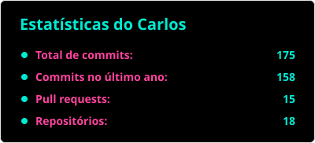
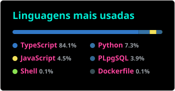

<div align="center">

```
 ██████╗██████╗  ██████╗ █████╗ ██╗   ██╗ █████╗ ██╗      ██████╗ █████╗ ███╗   ██╗████████╗██╗
██╔════╝██╔══██╗██╔════╝██╔══██╗██║   ██║██╔══██╗██║     ██╔════╝██╔══██╗████╗  ██║╚══██╔══╝██║
██║     ██║  ██║██║     ███████║██║   ██║███████║██║     ██║     ███████║██╔██╗ ██║   ██║   ██║
██║     ██║  ██║██║     ██╔══██║╚██╗ ██╔╝██╔══██║██║     ██║     ██╔══██║██║╚██╗██║   ██║   ██║
╚██████╗██████╔╝╚██████╗██║  ██║ ╚████╔╝ ██║  ██║███████╗╚██████╗██║  ██║██║ ╚████║   ██║   ██║
 ╚═════╝╚═════╝  ╚═════╝╚═╝  ╚═╝  ╚═══╝  ╚═╝  ╚═╝╚══════╝ ╚═════╝╚═╝  ╚═╝╚═╝  ╚═══╝   ╚═╝   ╚═╝
```


[](https://cdcavalcanti.pages.dev/)
[](https://www.linkedin.com/in/carlos-cavalcanti1b3231205/)
[](mailto:carlosedlima4@gmail.com)
[](https://wa.me/5583998268191)

</div>

---

## `$ whoami`

```yaml
nome: Carlos Eduardo Cavalcanti
local: João Pessoa (PB) · remoto
foco: back-end, automação e IA
atual: Analista de automação na IA Infinity
programando_desde: 2021
```

Desenvolvedor back-end que junta três coisas: **sistema de gestão, automação e IA**. Escrevo a API, ligo os sistemas e coloco agentes para trabalhar em processos reais. O número vem do banco, a frase vem do modelo, e a resposta não inventa preço.

- 🧠 **IA que não inventa:** RAG preso ao material da empresa, agentes com LangGraph e uma LLM treinada do zero (106 milhões de parâmetros) respondendo leads em produção.
- ⚙️ **Automação que roda sozinha:** n8n, WhatsApp API e webhooks ligados a qualquer CRM, de mercado ou feito sob medida.
- 🧱 **Back-end que aguenta produção:** NestJS, Fastify e Python com PostgreSQL, migrations versionadas, filas, permissões por papel e Docker.
- 🧾 **Motor fiscal brasileiro:** ICMS, ST, DIFAL, PIS/Cofins e já o IBS/CBS da reforma, com NF-e e NFC-e.

---

## `$ ls ~/projetos`

Quase tudo é privado (de clientes ou meu), então cada projeto tem uma **amostra ao vivo** no portfólio, com dados de exemplo.

| Projeto | O que faz | Stack | Amostra |
|---|---|---|:-:|
| **Digimob IA** | Atendimento de imobiliária com a LLM própria, em produção | Python · LLM · RAG | [▶ ver](https://cdcavalcanti.pages.dev/p/digimob-ia) |
| **LLM própria** | Modelo de linguagem treinado do zero, tokenizer BPE próprio | Python · PyTorch | [▶ ver](https://cdcavalcanti.pages.dev/p/llm-propria) |
| **Agente SDR no WhatsApp** | Qualifica o lead e passa a conversa para um humano | FastAPI · LangGraph | [▶ ver](https://cdcavalcanti.pages.dev/p/agente-sdr) |
| **Monitoramento de IAs** | Relatório diário: número do código, texto da IA | FastAPI · LangGraph | [▶ ver](https://cdcavalcanti.pages.dev/p/monitoramento-ias) |
| **ERP e PDV** | Gestão para PMEs com motor fiscal e NF-e | Fastify · PostgreSQL · RLS | [▶ ver](https://cdcavalcanti.pages.dev/p/erp-pdv) |
| **CRM white-label** | Funil de vendas com WhatsApp, um CRM por cliente | NestJS · Prisma | [▶ ver](https://cdcavalcanti.pages.dev/p/crm-white-label) |
| **Painéis de gestão** | ETL e data warehouse próprios no lugar de um BI | TypeScript · ETL · Docker | [▶ ver](https://cdcavalcanti.pages.dev/p/paineis-de-gestao) |

---

## `$ cat stack.txt`

<div align="center">

### IA


![OpenAI](https://img.shields.io/badge/OpenAI-412991?style=for-the-badge&logo=data%3Aimage%2Fsvg%2Bxml%3Bbase64%2CPHN2ZyB4bWxucz0iaHR0cDovL3d3dy53My5vcmcvMjAwMC9zdmciIHZpZXdCb3g9IjAgMCAyNCAyNCIgZmlsbD0iI2ZmZmZmZiI%2BPHBhdGggZD0iTTIyLjI4MTkgOS44MjExYTUuOTg0NyA1Ljk4NDcgMCAwIDAtLjUxNTctNC45MTA4IDYuMDQ2MiA2LjA0NjIgMCAwIDAtNi41MDk4LTIuOUE2LjA2NTEgNi4wNjUxIDAgMCAwIDQuOTgwNyA0LjE4MThhNS45ODQ3IDUuOTg0NyAwIDAgMC0zLjk5NzcgMi45IDYuMDQ2MiA2LjA0NjIgMCAwIDAgLjc0MjcgNy4wOTY2IDUuOTggNS45OCAwIDAgMCAuNTExIDQuOTEwNyA2LjA1MSA2LjA1MSAwIDAgMCA2LjUxNDYgMi45MDAxQTUuOTg0NyA1Ljk4NDcgMCAwIDAgMTMuMjU5OSAyNGE2LjA1NTcgNi4wNTU3IDAgMCAwIDUuNzcxOC00LjIwNTggNS45ODk0IDUuOTg5NCAwIDAgMCAzLjk5NzctMi45MDAxIDYuMDU1NyA2LjA1NTcgMCAwIDAtLjc0NzUtNy4wNzI5em0tOS4wMjIgMTIuNjA4MWE0LjQ3NTUgNC40NzU1IDAgMCAxLTIuODc2NC0xLjA0MDhsLjE0MTktLjA4MDQgNC43NzgzLTIuNzU4MmEuNzk0OC43OTQ4IDAgMCAwIC4zOTI3LS42ODEzdi02LjczNjlsMi4wMiAxLjE2ODZhLjA3MS4wNzEgMCAwIDEgLjAzOC4wNTJ2NS41ODI2YTQuNTA0IDQuNTA0IDAgMCAxLTQuNDk0NSA0LjQ5NDR6bS05LjY2MDctNC4xMjU0YTQuNDcwOCA0LjQ3MDggMCAwIDEtLjUzNDYtMy4wMTM3bC4xNDIuMDg1MiA0Ljc4MyAyLjc1ODJhLjc3MTIuNzcxMiAwIDAgMCAuNzgwNiAwbDUuODQyOC0zLjM2ODV2Mi4zMzI0YS4wODA0LjA4MDQgMCAwIDEtLjAzMzIuMDYxNUw5Ljc0IDE5Ljk1MDJhNC40OTkyIDQuNDk5MiAwIDAgMS02LjE0MDgtMS42NDY0ek0yLjM0MDggNy44OTU2YTQuNDg1IDQuNDg1IDAgMCAxIDIuMzY1NS0xLjk3MjhWMTEuNmEuNzY2NC43NjY0IDAgMCAwIC4zODc5LjY3NjVsNS44MTQ0IDMuMzU0My0yLjAyMDEgMS4xNjg1YS4wNzU3LjA3NTcgMCAwIDEtLjA3MSAwbC00LjgzMDMtMi43ODY1QTQuNTA0IDQuNTA0IDAgMCAxIDIuMzQwOCA3Ljg3MnptMTYuNTk2MyAzLjg1NThMMTMuMTAzOCA4LjM2NCAxNS4xMTkyIDcuMmEuMDc1Ny4wNzU3IDAgMCAxIC4wNzEgMGw0LjgzMDMgMi43OTEzYTQuNDk0NCA0LjQ5NDQgMCAwIDEtLjY3NjUgOC4xMDQydi01LjY3NzJhLjc5Ljc5IDAgMCAwLS40MDctLjY2N3ptMi4wMTA3LTMuMDIzMWwtLjE0Mi0uMDg1Mi00Ljc3MzUtMi43ODE4YS43NzU5Ljc3NTkgMCAwIDAtLjc4NTQgMEw5LjQwOSA5LjIyOTdWNi44OTc0YS4wNjYyLjA2NjIgMCAwIDEgLjAyODQtLjA2MTVsNC44MzAzLTIuNzg2NmE0LjQ5OTIgNC40OTkyIDAgMCAxIDYuNjgwMiA0LjY2ek04LjMwNjUgMTIuODYzbC0yLjAyLTEuMTYzOGEuMDgwNC4wODA0IDAgMCAxLS4wMzgtLjA1NjdWNi4wNzQyYTQuNDk5MiA0LjQ5OTIgMCAwIDEgNy4zNzU3LTMuNDUzN2wtLjE0Mi4wODA1TDguNzA0IDUuNDU5YS43OTQ4Ljc5NDggMCAwIDAtLjM5MjcuNjgxM3ptMS4wOTc2LTIuMzY1NGwyLjYwMi0xLjQ5OTggMi42MDY5IDEuNDk5OHYyLjk5OTRsLTIuNTk3NCAxLjQ5OTctMi42MDY3LTEuNDk5N1oiLz48L3N2Zz4%3D)


### Back-end


### Dados


### Automação e integrações


### Infra


</div>

---

## `$ git log --stat`

<div align="center">
  <a href="https://github.com/cdcavalcanti">
    
    
  </a>
</div>

---

<div align="center">

**Quer automatizar um processo ou colocar IA para trabalhar de verdade?**

[](https://wa.me/5583998268191)
[](https://cdcavalcanti.pages.dev/)

<sub>programando desde 2021 · João Pessoa (PB)</sub>

</div>
